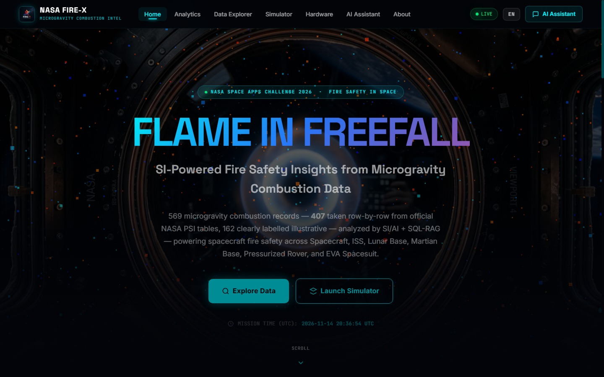
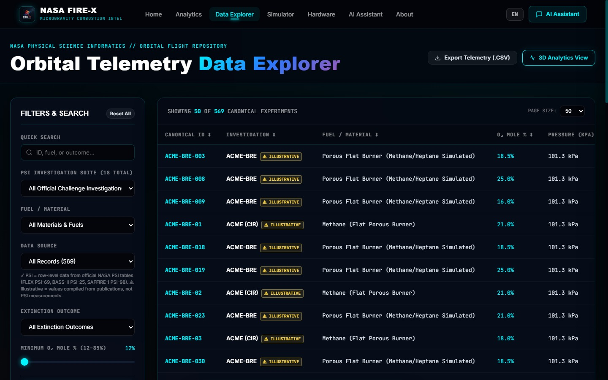
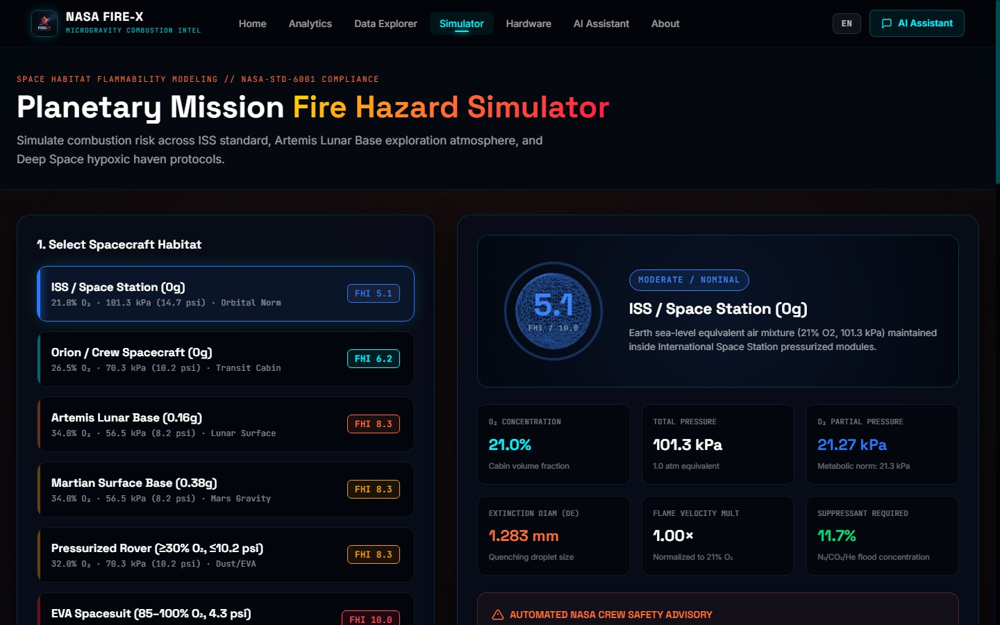
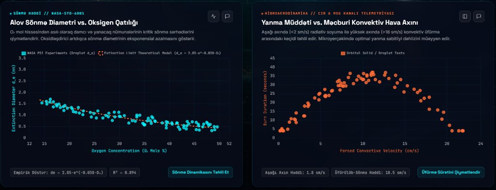
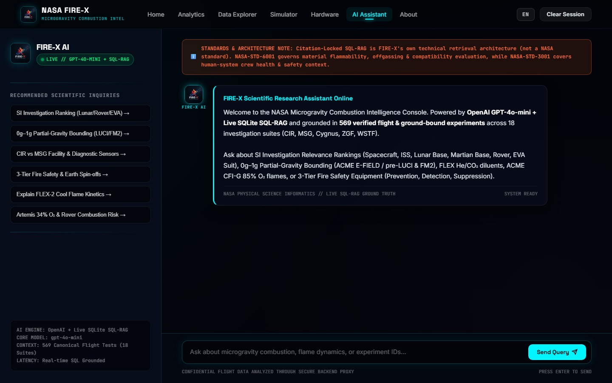
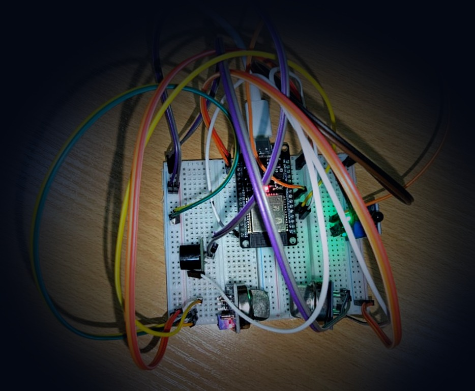
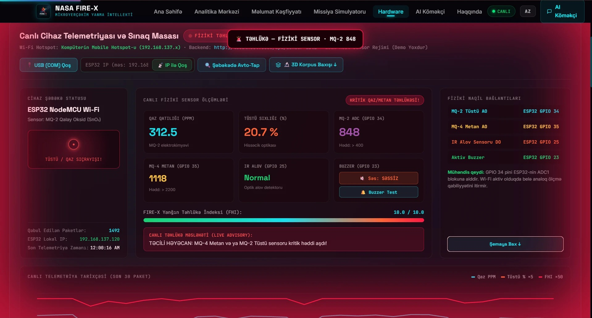
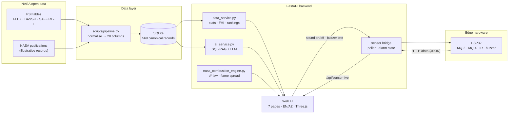
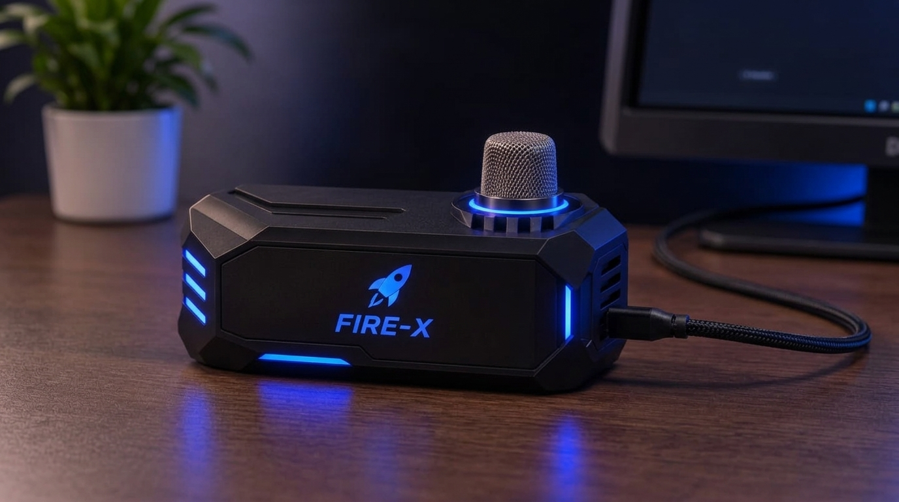

<div align="center">


# FIRE-X

### Microgravity combustion intelligence: from NASA flight data to a live fire-safety sensor node

**NASA Space Apps Challenge 2026 · *Flame in Freefall: AI-Powered Fire Safety Insights from Microgravity Combustion Data***
**Team SpaceAz · Ganja, Azerbaijan**

<p>
  
  
  <a href="https://fire-x.onrender.com/"></a>
</p>
<p>
  
  
  
  
  
  
  <a href="https://github.com/Hekimovraiz/project_FIRE-X/actions/workflows/ci.yml"></a>
  <a href="LICENSE"></a>
</p>

**[Live demo](https://fire-x.onrender.com/)** · **[Quick start](#-quick-start)** · **[Architecture](docs/ARCHITECTURE.md)** · **[Hardware](docs/HARDWARE.md)** · **[API](docs/API.md)** · **[Data provenance](docs/DATA_PROVENANCE.md)** · **[Challenge fit](docs/CHALLENGE_ALIGNMENT.md)** · **[Presentation (PDF)](presentation/FIRE-X_Teqdimat.pdf)**



</div>

---

## 🔥 Why this matters

On Earth, hot gas rises and pulls fresh oxygen into a flame. In orbit there is no buoyancy, so flames are **spherical, slower, cooler and harder to detect**. Some of them (the "cool flames" found in NASA's FLEX experiments) burn at temperatures that ordinary smoke and heat detectors were never designed for.

Fire has already shaped spaceflight history: **Apollo 1** (1967), the **Mir** oxygen-candle fire (1997), and every crewed mission since has treated fire as one of the highest crew risks. As missions move to the **Moon (0.16 g)** and **Mars (0.38 g)**, engineers need to know how materials burn in gravity levels where almost no data exist yet.

**FIRE-X turns NASA's microgravity combustion records into answers a mission designer can use**, and pairs them with a physical sensor node that shows the same logic working on real hardware.

## ✨ What FIRE-X does

| | Module | What you get |
|:--:|:--|:--|
| 🏠 | **Mission Control** (`/`) | Live KPI counters, ISS-cupola hero scene and a microgravity flame particle field |
| 📊 | **Analytics Hub** (`/analytics`) | Extinction diameter vs O₂, burn time vs airflow, material hierarchy, outcome frequencies and a rotatable 3D/4D telemetry cube |
| 🗄️ | **Data Explorer** (`/explorer`) | Filter all 569 records by family, fuel, outcome, O₂ range and **data source**; inspector drawer, comparison dock and CSV export with provenance |
| 🪐 | **Mission Simulator** (`/simulator`) | Fire Hazard Index (1–10) and ranked NASA investigations for ISS, Orion, lunar base, Mars base, pressurized rover, EVA suit or a custom atmosphere |
| 🤖 | **AI Research Assistant** (`/ai`) | Chat grounded in live SQL queries over the database (SQL-RAG); every answer cites experiment IDs and labels verified vs illustrative data |
| 📡 | **Hardware Node** (`/hardware`) | ESP32 with MQ-2 smoke, MQ-4 methane and IR flame sensors, a siren buzzer and a live dashboard fed by the board over Wi-Fi |
| 📚 | **About & Provenance** (`/about`) | Facility matrix (ISS CIR / MSG / Cygnus), 3-tier safety equipment impact, Earth spin-offs and scope notes |

Everything is available in **English and Azerbaijani** with one click.

## 🖼️ Screenshots

<table>
  <tr>
    <td width="50%"><br/><sub><b>Data Explorer</b>: 569 records with a provenance filter and CSV export</sub></td>
    <td width="50%"><br/><sub><b>Mission Simulator</b>: Fire Hazard Index and ranked investigations per habitat</sub></td>
  </tr>
  <tr>
    <td><br/><sub><b>Analytics Hub</b>: extinction and airflow correlations from PSI data</sub></td>
    <td><br/><sub><b>AI Research Assistant</b>: SQL-grounded answers with experiment citations</sub></td>
  </tr>
  <tr>
    <td><br/><sub><b>Sensor node</b>: ESP32 + MQ-2 + MQ-4 + IR flame + buzzer</sub></td>
    <td><br/><sub><b>Live dashboard</b>: readings streamed from the board in real time</sub></td>
  </tr>
</table>

## 🧭 Architecture



More detail, including the request flow of the AI assistant and the alarm state machine, is in **[docs/ARCHITECTURE.md](docs/ARCHITECTURE.md)**.

## 🛰️ The data, honestly labelled

| Source | Records | Status |
|:--|:--:|:--|
| **FLEX** droplet combustion (NASA PSI-69, ISS CIR) | 274 | ✅ `psi_verified` |
| **BASS-II** solid burning (NASA PSI-25, ISS MSG) | 129 | ✅ `psi_verified` |
| **SAFFIRE-I** large-scale burns (NASA PSI-98, Cygnus) | 4 | ✅ `psi_verified` |
| FLEX-2, BASS-I, SAFFIRE-II/III, ACME (BRE, CFI, CFI-G, CLD, E-FIELD), SPICE, SLICE, SAME, SAME-R, DAFT | 162 | ⚠️ `illustrative` |
| **Total** (18 investigation sub-suites) | **569** | |

**407 records are row-level exports of official NASA PSI tables.** The other 162 were compiled by the team from NASA publications to cover investigations that have no public table yet. We never hide which is which: the API, the Explorer, the CSV export and the AI assistant all carry a `data_provenance` label, and `GET /api/experiments?provenance=psi_verified` returns only PSI-table rows.

Full method and column dictionary: **[docs/DATA_PROVENANCE.md](docs/DATA_PROVENANCE.md)** · **[docs/data_dictionary.md](docs/data_dictionary.md)** · **[Nasa_data/README.md](Nasa_data/README.md)**.

## 📡 The hardware node



The sensor node is a small, honest analogue of a spacecraft fire detector: it watches for the **products of combustion**, not just visible flame.

- **ESP32** on 2.4 GHz Wi-Fi, serving JSON at `/data`
- **MQ-2** (smoke / LPG) on GPIO 34 and **MQ-4** (methane) on GPIO 35, both on ADC1 so they work alongside Wi-Fi
- **IR flame sensor** on GPIO 25 (digital) for direct flame detection
- **Passive buzzer** on GPIO 23 driven with `tone()` as a rising "beep-beep" siren
- **Auto-baseline** gas logic: 60 s heater warm-up, smoothed readings, a slowly tracked clean-air baseline, and an alarm when a sensor rises above that baseline (plus an absolute ceiling)
- **Alarm latch** that rings for 5 s, re-warns every 15 s while the hazard lasts and clears only after 1 s of clean readings
- **3D-printed enclosure** (`hardware/*.stl`) with airflow slots and an acoustic port, viewable in the browser at `/hardware/3d-viewer`

A background thread in the backend polls the board about once a second, mirrors its alarm state to every open page as a visual banner, and can switch the buzzer on and off or run a 3 s test from the dashboard.

Wiring, flashing steps, network setup and troubleshooting: **[docs/HARDWARE.md](docs/HARDWARE.md)**.
<br clear="right"/>

## ⚡ Quick start

**Requirements:** Python 3.12+, Git. An OpenAI API key is optional: without it the AI assistant falls back to a deterministic, database-grounded answer.

```bash
git clone https://github.com/Hekimovraiz/project_FIRE-X.git
cd project_FIRE-X
python -m venv .venv
```

```bash
# Windows
.venv\Scripts\activate
# macOS / Linux
source .venv/bin/activate
```

```bash
pip install -r requirements.txt
cp .env.example .env      # then add OPENAI_API_KEY if you have one
uvicorn backend.main:app --host 0.0.0.0 --port 8000
```

Open **http://localhost:8000**. The pre-built SQLite database ships with the repository, so no data step is needed.

<details>
<summary><b>Optional: Streamlit analytics panel, data rebuild, tests</b></summary>

```bash
pip install streamlit plotly pandas
streamlit run analytics_dashboard_v2.py      # stand-alone analytics panel

python scripts/pipeline.py                   # rebuild the canonical dataset from Nasa_data/

pip install -r requirements-dev.txt
pytest -q                                    # API smoke tests (same as CI)
```
</details>

<details>
<summary><b>Configuration (environment variables)</b></summary>

| Variable | Default | Purpose |
|:--|:--|:--|
| `OPENAI_API_KEY` | none | Enables LLM answers in the AI assistant (server-side only, never sent to the browser) |
| `OPENAI_MODEL` | `gpt-4o-mini` | Model used by the assistant |
| `MQ2_DANGER_THRESHOLD` | `850` | Fallback MQ-2 ADC threshold when the board does not send its own verdict |
| `MQ4_DANGER_THRESHOLD` | `2700` | Fallback MQ-4 ADC threshold |
| `ESP32_HTTP_TIMEOUT` | `2.0` | Seconds to wait for the board on each poll |
</details>

## 🔌 API at a glance

| Method | Endpoint | What it returns |
|:--|:--|:--|
| `GET` | `/api/health` | Service status, record counts (total and PSI-verified) |
| `GET` | `/api/stats` | Aggregates, distributions and scatter data for the charts |
| `GET` | `/api/experiments` | Paginated, filterable records (`family`, `fuel`, `outcome`, `min_o2`, `max_o2`, `provenance`) |
| `GET` | `/api/experiments/export.csv` | The filtered set as CSV, with a provenance column |
| `GET` | `/api/experiments/{id}` | One record with all 28 fields |
| `POST` | `/api/compare` | Side-by-side comparison of 2–4 records |
| `GET` | `/api/mission-scenario/{id}` | Fire Hazard Index and ranked investigations for a habitat |
| `GET` | `/api/investigation-rankings` | Investigation relevance for every target environment |
| `POST` | `/api/chat-assistant` · `/api/ask-ai` | SQL-RAG grounded AI answers (EN / AZ) |
| `POST` | `/api/combustion/predict-*` | Droplet-extinction and solid flame-spread estimates |
| `GET` | `/api/sensor-live` | Latest hardware reading and alarm state |
| `POST` | `/api/sensor-sound` · `/api/sensor-buzzer-test` | Control the board's buzzer |

Interactive docs are generated automatically at **`/docs`** (Swagger) and **`/redoc`**. Full reference with examples: **[docs/API.md](docs/API.md)**.

```bash
curl "http://localhost:8000/api/experiments?provenance=psi_verified&min_o2=21&limit=5"
curl "http://localhost:8000/api/mission-scenario/lunar_habitat"
```

## 🎯 How FIRE-X answers the challenge

| Challenge asks for | FIRE-X delivers |
|:--|:--|
| Use NASA microgravity combustion data (PSI) | 407 PSI-table rows (FLEX, BASS-II, SAFFIRE-I) as the verified core, all 18 named investigations covered |
| AI that produces fire-safety insights | SQL-RAG assistant that cites experiment IDs and refuses to invent data |
| Insights for spacecraft and future habitats | Mission simulator for ISS, Orion, lunar and Mars bases, rover and EVA suit |
| Bound partial-gravity behaviour (no LUCI / FM2 data yet) | 0 g ↔ 1 g bounding for 0.16 g and 0.38 g environments |
| Prevention, detection, suppression | 3-tier equipment advisories; a working detection node built from the same principles |
| Benefit on Earth | Spin-offs for buildings, vehicles and industrial gas leaks, shown live by the sensor node |

Detailed mapping: **[docs/CHALLENGE_ALIGNMENT.md](docs/CHALLENGE_ALIGNMENT.md)**.

## 📂 Repository layout

```text
project_FIRE-X/
├── backend/                  FastAPI app, data service, SQL-RAG AI, combustion engine, sensor bridge
├── frontend/                 7 HTML pages, CSS design system, JS (charts, explorer, simulator, EN/AZ)
├── hardware/                 ESP32 firmware, enclosure STL files, 3D viewer, CAD generator
├── Nasa_data/                Source CSV files from NASA PSI and publications
├── data/processed/           Canonical 569-row dataset (28 columns)
├── scripts/                  Data pipeline and PDF report generator
├── docs/                     Architecture, hardware, API, data provenance, challenge fit
├── presentation/             Judging deck (HTML + PDF) and its image assets
├── tests/                    API smoke tests run by CI
├── analytics_dashboard_v2.py Stand-alone Streamlit analytics panel
└── fire_safety.db            Pre-built SQLite database
```

## 👥 Team SpaceAz

| Member | Role | Focus |
|:--|:--|:--|
| **Murad Fatullazada** | Team lead · Hardware | ESP32 sensor node, firmware, 3D-printed enclosure |
| **Sabir Məmmədzadə** | Backend · Systems | FastAPI backend, combustion engine, REST API |
| **Raiz Həkimov** | Frontend · 3D | Web UI, Three.js scenes, bilingual engine |
| **Şahvələd Vəlizadə** | Security · Safety | AI guardrails, citation checks, rate limiting |
| **Hüseyn Alırzayev** | Data science | NASA PSI ingestion, empirical models, analytics panel |

## 🤝 Contributing, security and citation

- Want to help? Read **[CONTRIBUTING.md](CONTRIBUTING.md)** and our **[Code of Conduct](CODE_OF_CONDUCT.md)**.
- Found a vulnerability? See **[SECURITY.md](SECURITY.md)**.
- Using FIRE-X in research? GitHub's **"Cite this repository"** button reads **[CITATION.cff](CITATION.cff)**.
- What changed and when: **[CHANGELOG.md](CHANGELOG.md)**.

## ⚠️ Disclaimer

FIRE-X is a **decision-support and education tool**, not a certified fire-safety system. Its hazard scores and AI answers summarise published experiments and must not replace NASA-STD-6001 material testing or a flight-qualified detector. Illustrative records are labelled as such and should not be cited as NASA measurements.

## 🙏 Acknowledgements

Data from the **NASA Physical Sciences Informatics (PSI)** system ([psi.nasa.gov](https://psi.nasa.gov)) and the **NASA Technical Reports Server** ([ntrs.nasa.gov](https://ntrs.nasa.gov)). Built for the **NASA International Space Apps Challenge 2026**. NASA does not endorse this project.

## 📄 License

Released under the **[MIT License](LICENSE)**.

<div align="center">
<br/>
<sub>Made in Ganja, Azerbaijan 🇦🇿 by Team SpaceAz, for everyone who will one day live beyond Earth.</sub>
</div>
