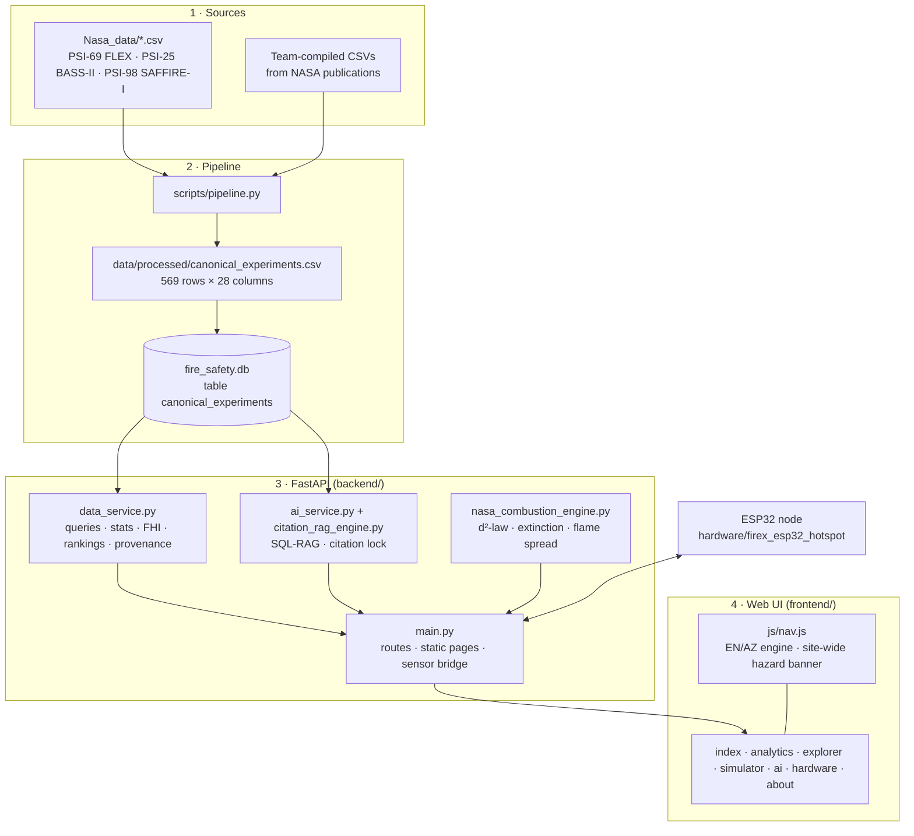
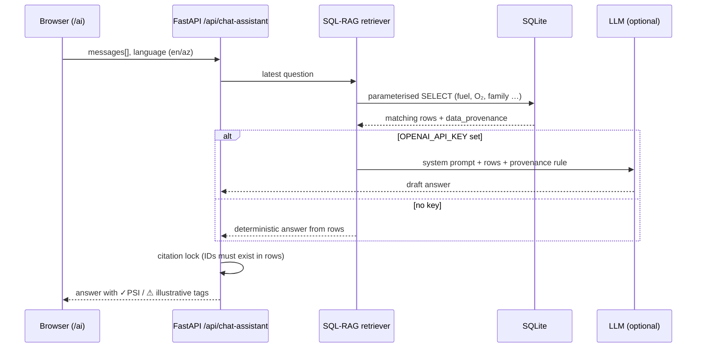
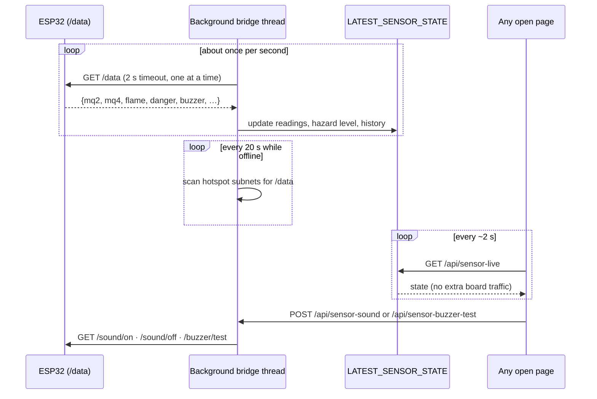

# FIRE-X Architecture

FIRE-X has four layers: **NASA data → SQLite → FastAPI → web UI**, plus an **ESP32 edge node** that feeds live readings into the same backend. Every layer runs on a laptop with no cloud services required. The only optional external call is the LLM used by the AI assistant.

## Backend modules

| File | Responsibility |
|:--|:--|
| `backend/main.py` | FastAPI app (`v2.2.0`), all REST routes, HTML page routes, background ESP32 bridge thread, serial-line parser, input validation (for example, only private LAN IPs are accepted for the board address to prevent SSRF) |
| `backend/data_service.py` | Read-only access to SQLite: filtered queries, aggregates for charts, Fire Hazard Index, investigation relevance rankings, `provenance_of()` labelling |
| `backend/ai_service.py` | Builds the SQL-RAG context, calls the LLM when a key is configured, otherwise writes a deterministic answer from the same rows |
| `backend/citation_rag_engine.py` | Forces answers to cite experiment IDs and replaces ungrounded claims with a safe fallback |
| `backend/nasa_combustion_engine.py` | Physics helpers: droplet burning (d²-law), extinction diameter, low-flow solid flame spread |

## Request flow: AI assistant

Design choices:

- **SQL, not vectors.** The data are numeric tables, so exact SQL filters beat embedding similarity and every number in an answer can be traced to a row.
- **Provenance in the prompt.** Rows carry `data_provenance`, and the system prompt forbids presenting illustrative rows as NASA measurements.
- **Key stays on the server.** The browser never sees the API key.

## Request flow: hardware node

Why it is built this way:

- **One poller only.** The ESP32 web server handles one connection at a time. Earlier versions let every browser tab poll the board directly, which froze it. Now a single backend thread talks to the board behind a lock, and pages read a cached state.
- **The board decides.** The firmware computes its own `danger` flag from a self-calibrated baseline. The backend uses that flag when present and falls back to fixed thresholds (`MQ2_DANGER_THRESHOLD`, `MQ4_DANGER_THRESHOLD`) for older firmware.
- **Commands are retried.** If a sound on/off command cannot reach the board, it is kept as `pending_sound_command` and resent on the next successful poll.
- **Stale data is cleared.** If no packet arrives for 10 s, the state drops back to `SEARCHING` and readings reset to zero, so the UI never shows old numbers as live.

## Frontend

- Plain HTML, CSS and JavaScript (no build step), served by FastAPI.
- `css/ds.css` holds the design tokens; `js/nav.js` holds the navigation, the EN/AZ dictionaries (with a `MutationObserver` that translates dynamic content) and the site-wide visual hazard banner.
- Three.js renders the 3D scenes; Chart.js renders the 2D charts.

## Deployment

| Target | Config | Notes |
|:--|:--|:--|
| Render | `render.yaml` | Python web service, `uvicorn backend.main:app` |
| Vercel | `vercel.json` + root `main.py` | Serverless entry point that imports the backend app |
| Local / Cloudflare Tunnel | none | `uvicorn` on port 8000, then `cloudflared tunnel --url http://127.0.0.1:8000` |

The hardware node needs the backend on the **same local network** as the board (for example, a Windows Mobile Hotspot). A cloud deployment shows the dashboard but cannot reach a board on a private network.
