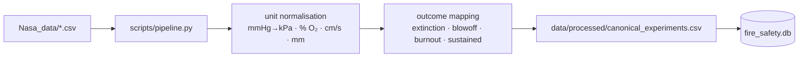

# Data Provenance

FIRE-X holds **569 canonical records** from **18 investigation sub-suites**. They come from two very different kinds of source, and the project labels every record so nobody confuses them.

## The two tiers

| Tier | Label | Records | What it is |
|:--|:--|:--:|:--|
| Verified | `psi_verified` | **407** | Row-level exports of official tables published on NASA Physical Sciences Informatics (PSI) |
| Illustrative | `illustrative` | **162** | Values compiled by the team from NASA papers, reports and summaries, for investigations that have no public PSI table |

### Verified records (407)

| Family | PSI ID | Facility | Records | Source file |
|:--|:--|:--|:--:|:--|
| FLEX | PSI-69 | ISS Combustion Integrated Rack (MDCA) | 274 | `Nasa_data/PSI-69_Experimental table_FLEX.csv` |
| BASS-II | PSI-25 | ISS Microgravity Science Glovebox | 129 | `Nasa_data/PSI-25_Experimental table_BASS-II.csv` |
| SAFFIRE-I | PSI-98 | Cygnus cargo vehicle | 4 | `Nasa_data/PSI-98_Experimental table_SAFFIRE-1.csv` |

### Illustrative records (162)

| Family | Records |
|:--|:--:|
| SAME | 50 |
| ACME-CLD | 22 |
| ACME-BRE | 13 |
| ACME-CFI | 13 |
| ACME-EFIELD | 12 |
| FLEX-2 | 10 |
| ACME (CIR) | 8 |
| BASS-I | 8 |
| SLICE | 8 |
| SAFFIRE-II | 5 |
| ACME-CFI-G | 4 |
| SPICE | 3 |
| SAFFIRE-III | 2 |
| SAME-R | 2 |
| DAFT / DAFT-2 | 2 |

These rows let the platform cover every investigation the challenge names. Their values are plausible and consistent with the literature, but they are **not measurements** and should not be cited as NASA data.

## Where the label shows up

| Place | How |
|:--|:--|
| API | Every record has `data_provenance` and `provenance_source` fields |
| API filter | `GET /api/experiments?provenance=psi_verified` (or `illustrative`) |
| Health and stats | `/api/health` → `psi_verified_records`; `/api/stats` → `psi_verified_experiments`, `illustrative_experiments` |
| CSV export | `/api/experiments/export.csv` includes the provenance column |
| Explorer page | "Data Source" filter, a badge on each row, a warning in the inspector for illustrative rows |
| AI assistant | Retrieved rows are tagged ✓PSI or ⚠ illustrative; the system prompt forbids presenting illustrative rows as measurements |

The rule lives in one function, `provenance_of()` in `backend/data_service.py`: a record is `psi_verified` only if its family is FLEX, BASS-II or SAFFIRE-I.

## Pipeline

- Column definitions: [`data_dictionary.md`](data_dictionary.md)
- Source catalogue and links: [`sources.md`](sources.md) and [`../Nasa_data/README.md`](../Nasa_data/README.md)
- The backend only **reads** the database. Its start-up check logs families outside the challenge scope but never deletes rows.

## Partial gravity

PSI has no partial-gravity combustion data yet (LUCI and FM2 are future experiments). FIRE-X follows the challenge's own guidance and **bounds** lunar (0.16 g) and Martian (0.38 g) behaviour between microgravity results and normal-gravity results. The simulator presents these as ranges, not predictions.

## Out of scope

Rocket propellants (LH₂/LOX, RP-1, hypergolics) are deliberately excluded. Engine combustion is high-pressure and turbulent, while habitat fire safety concerns slow (0–30 cm/s) laminar flames and material flammability.
