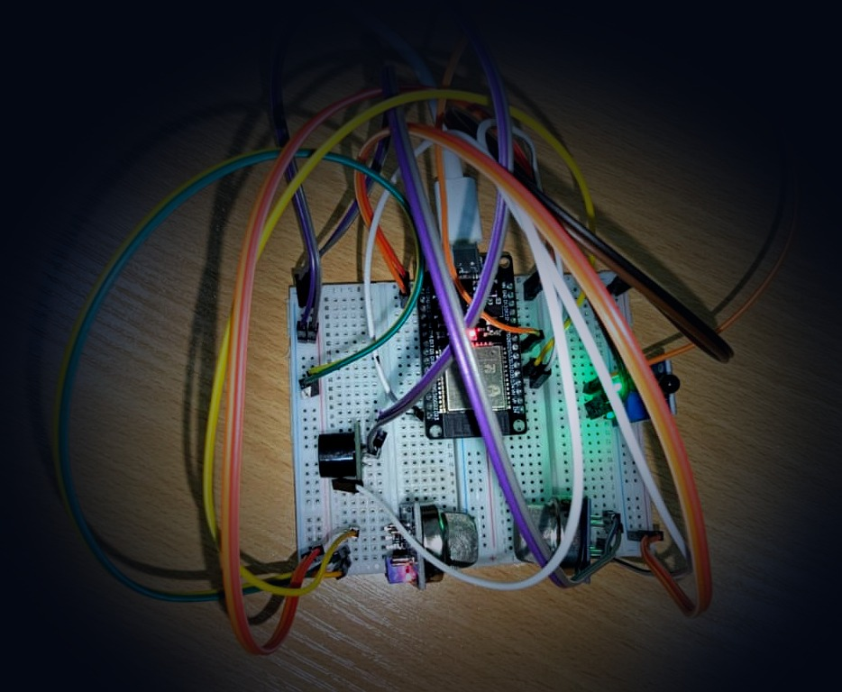
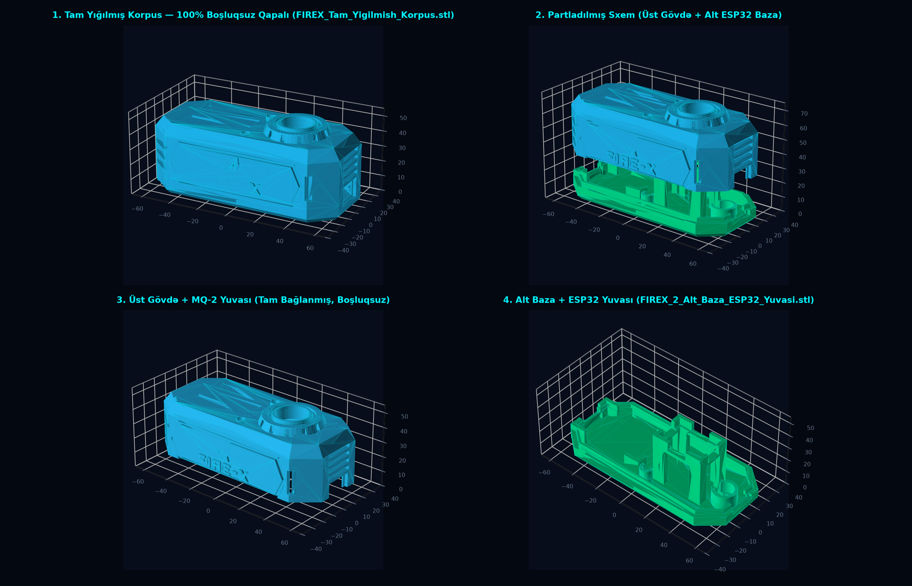
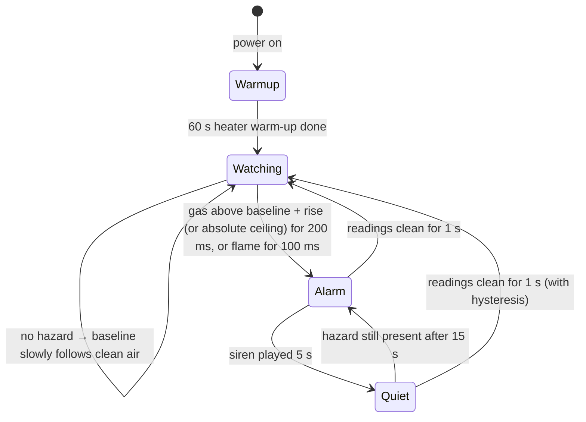

# FIRE-X Hardware Node

A low-cost fire and gas detector built on an ESP32. It streams readings to the FIRE-X backend over Wi-Fi and sounds a siren when it detects smoke, methane or an open flame.

<p align="center">
  
  
</p>

## Why a hardware node in a data challenge?

The challenge is about turning microgravity combustion data into fire-safety insight. Spacecraft detect fire mostly from its **products** (smoke particles and gases) because flames in microgravity can be small, dim and cool. The node puts that principle on a desk:

- **MQ-2** reacts to smoke and combustible gases, playing the role of a cabin smoke detector.
- **MQ-4** reacts to methane, a fuel gas and pyrolysis product.
- **IR flame sensor** gives a direct optical check, like the cameras in NASA's combustion racks.
- The backend turns the readings into the same **Fire Hazard Index** used in the Mission Simulator, so data-driven and sensor-driven risk are shown on one scale.

It also demonstrates the Earth spin-off the challenge asks for: the same logic protects kitchens, garages and industrial sites.

## Bill of materials

| Part | Qty | Notes |
|:--|:--:|:--|
| ESP32 DevKit (ESP32-WROOM-32) | 1 | Any 30/38-pin board |
| MQ-2 gas/smoke module | 1 | Analogue output (AO) used |
| MQ-4 methane module | 1 | Analogue output (AO) used |
| IR flame sensor module (3- or 4-pin) | 1 | Digital output (DO); the AO pin is optional |
| Passive buzzer | 1 | Driven with `tone()` |
| Breadboard, jumper wires | — | |
| 5 V USB supply | 1 | The MQ heaters draw about 150 mA each |
| 3D-printed enclosure | 1 | `hardware/FIREX_1_Ust_Govde_Korpus.stl` (top), `hardware/FIREX_2_Alt_Baza_ESP32_Yuvasi.stl` (base) |

## Wiring

| Module pin | ESP32 pin | Why this pin |
|:--|:--|:--|
| MQ-2 AO | **GPIO 34** | ADC1 input. ADC2 pins stop working when Wi-Fi is on. |
| MQ-4 AO | **GPIO 35** | ADC1 input |
| IR flame DO | **GPIO 25** | Digital read only, so ADC2 is fine here |
| IR flame AO (optional) | **GPIO 33** | ADC1, used only if `IR_USE_ANALOG = true` |
| Buzzer + | **GPIO 23** | PWM-capable output |
| VCC (MQ modules) | 5 V (VIN) | The heaters need 5 V |
| VCC (IR module) | 3.3 V | |
| All GND | GND | Common ground |

> MQ module AO can reach about 4 V at 5 V supply. In practice the modules' load resistor keeps it lower, but for long-term use add a voltage divider (for example, 10 kΩ / 20 kΩ) to keep the ESP32 input under 3.3 V.

A wiring map is in `images/breadboard_wiring_map.svg` and a schematic in `images/esp32_mq2_circuit.png`.

## Firmware

The current firmware is **`hardware/firex_esp32_hotspot/firex_esp32_hotspot.ino`**. (Files directly under `hardware/esp32_mq2_firex*` are earlier versions kept for history.)

### Flashing

1. Install the Arduino IDE (or `arduino-cli`) and the **esp32 by Espressif** board package (tested with core 3.x).
2. Copy `secrets.example.h` to `secrets.h` in the same folder and put your Wi-Fi name and password in it. `secrets.h` is git-ignored, so the password never reaches GitHub.
3. Select board **ESP32 Dev Module**, choose the COM port and upload.
4. Open the Serial Monitor at **115200 baud**. After it connects you will see a line like:

```text
[FIRE-X] IP: 192.168.137.125 | MQ-2: 412 | MQ-4: 1630 (fon 380/1590, hedd 630/2090) | Alov: YOX | Ses: ON | Tehluke: YOX | Buzzer: OFF
```

### Detection logic



| Setting | Value | Meaning |
|:--|:--|:--|
| `WARMUP_MS` | 60 000 | No gas alarms while the MQ heaters warm up |
| `SMOOTH_ALPHA` | 0.2 | Exponential smoothing on 16-sample averages to remove ADC noise |
| `BASELINE_ALPHA` | 0.002 | How fast the clean-air baseline follows slow drift (only when no hazard) |
| `MQ2_RISE` / `MQ4_RISE` | 250 / 500 | ADC rise above baseline that counts as a hazard |
| `MQ2_ABSOLUTE` / `MQ4_ABSOLUTE` | 1800 / 3000 | Hazard regardless of baseline |
| `MQ_HYSTERESIS` | 60 | Reading must fall this far below the threshold to clear |
| `GAS_CONFIRM_MS` / `FLAME_CONFIRM_MS` | 200 / 100 | Ignore single-sample spikes |
| `CLEAR_CONFIRM_MS` | 1000 | Time of clean readings before the alarm clears |
| `ALARM_DURATION_MS` | 5000 | Siren length per alarm |
| `ALARM_REPEAT_MS` | 15 000 | Re-warn interval while the hazard lasts (0 = never) |

Why a moving baseline? MQ sensors drift with temperature, humidity and heater age, so a fixed number such as "400" triggers false alarms on one day and misses smoke on another. Comparing against the sensor's own recent clean-air level is the same approach many commercial gas detectors use.

### Siren

`SIREN_STYLE = SIREN_BIIP` sweeps 900 → 1800 Hz in 350 ms "beeps" separated by 450 ms of silence. The sound can be muted from the dashboard; **Buzzer Test** plays it for 3 s even when muted.

### HTTP interface on the board

| Path | Response |
|:--|:--|
| `GET /data` | JSON: `mq2`, `mq4`, `flame`, `sound`, `danger`, `buzzer`, `ir_ao`, `mq2_base`, `mq4_base`, `mq2_th`, `mq4_th`, `warmup`, `ip` (CORS enabled) |
| `GET /sound/on` · `/sound/off` | Unmute / mute the siren |
| `GET /buzzer/test` | Play the siren for 3 s |
| `GET /` | Small human-readable status page |

## Network setup

The backend must be on the same network as the board.

1. On Windows: **Settings → Network → Mobile hotspot**. Set the band to **2.4 GHz** (the ESP32 cannot join 5 GHz).
2. Use exactly the same SSID and password in `secrets.h`.
3. Start the backend: `uvicorn backend.main:app --host 0.0.0.0 --port 8000`.
4. Open `http://localhost:8000/hardware`. The backend scans the hotspot subnet (`192.168.137.x`) every 20 s and connects automatically. You can also type the IP from the Serial Monitor.

## Troubleshooting

| Symptom | Likely cause and fix |
|:--|:--|
| Serial Monitor shows dots, never an IP | Hotspot is on 5 GHz or the SSID or password differs (case and spaces matter) |
| Site says "searching" but Serial shows an IP | PC and board are on different networks, or Windows Firewall blocks Python. Open `http://<board-ip>/data` in a browser to test. |
| Upload fails, "port busy" | Close the Arduino Serial Monitor or any page using WebSerial |
| Buzzer silent | Passive buzzers need `tone()` (`BUZZER_USE_TONE = true`); check GPIO 23 and ground |
| Gas reading jumps right after power-on | Normal heater warm-up. Wait 60 s; alarms are suppressed meanwhile. |
| IR sensor triggers in sunlight | Turn the module's potentiometer down or shield it from direct sun |

## Enclosure

The enclosure was generated in code by `hardware/generate_3d_enclosure.py`: a base with an ESP32 cradle and a top shell with gas-inlet slots and an acoustic port for the buzzer. Open `/hardware/3d-viewer` in the running app to rotate it, or load the STL files into any slicer (PLA, 0.2 mm layers, no supports needed for the base).
